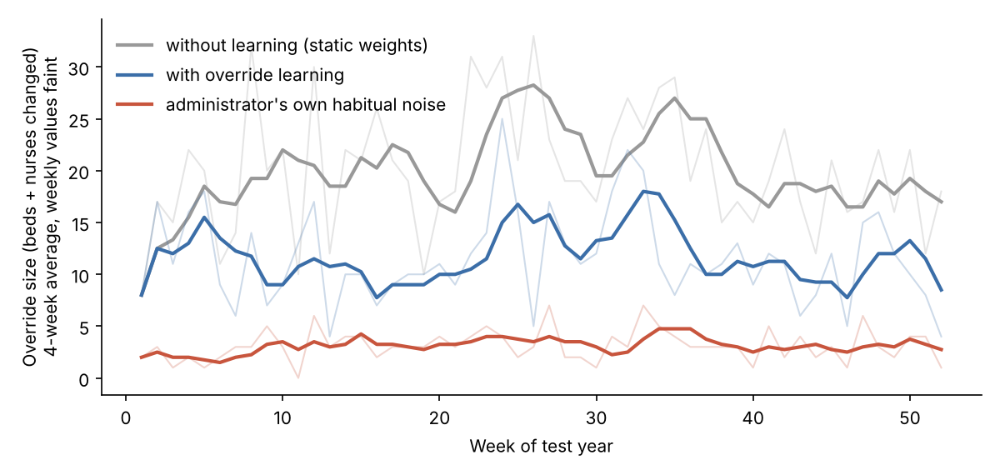

# Results: forecast-then-allocate on semi-synthetic data

> **Data notice.** Every number below comes from the semi-synthetic hospital simulator in `hcalloc.data.synthetic` (seed 0). Staffing, equipment and administrator behaviour are simulated. These results test the method; they are not evidence about any real hospital.

Run time: 1415 s. Evaluation: one plan every Sunday for Monday to Sunday, 52 weeks in the test year. Costs are in units of one rostered nurse-day. Regret is realised cost minus the cost of the best plan made with perfect foresight.

## Key findings

- **Uncertainty-aware planning, normal year:** joint + CVaR is 12.3% above perfect foresight, against 16.6% for the best method that ignores uncertainty (80th percentile + optimiser), a 26% cut in regret.
- **Uncertainty-aware planning, stress-wave year:** joint + CVaR is 10.1% above perfect foresight, against 13.6% for the best method that ignores uncertainty (80th percentile + optimiser), a 25% cut in regret.
- **Coupled fixed and movable resources:** planning beds, nurses and pumps together was cheaper than planning them one after another on the normal year (-2.3 per week, 95% CI -4.0 to -0.6). The sensitivity table shows when coupling matters more.
- **Risk term (CVaR, weight 0.3):** worst-10%-week cost was 891 with CVaR vs 892 without (normal year) and 1,300 vs 1,300 (stress year). Mean weekly cost difference: +1.6 per week, 95% CI -0.9 to +3.9. In these runs the risk term did not clearly reduce bad-week cost.
- **Choosing forecasters by decisions:** Spearman rank correlation with decision regret across forecasters was 1.00 for CRPS and 0.90 for MAE (CRPS tracked regret more closely than MAE). Validation regret picked `negbin_glm` (scale 0.75) and MAE picked `flow`. On the test year the regret pick minus the MAE pick was +0.2 per week, 95% CI -2.4 to +2.7, so the choice made no measurable difference. Tuning the scenario spread by regret mattered for the weaker models: `seasonal_naive` preferred scale 1.25 (90% coverage 0.93), i.e. wider scenarios than plain conformal calibration gave.
- **Override learning:** over the last 8 weeks, overrides were 43% smaller with learning (10.2 vs 18.0 beds + nurses changed per week; habitual noise alone 3.0). Learned weights ended at (2.0, 0.6) for a true (1.8, 0.5). This shows the mechanism works on a simulated administrator only.
- **Sensitivity:** joint + CVaR had lower regret than the point-forecast optimiser in every variant, by 0.2 points (bed cost 1.0 (beds as costly as a nurse)) up to 9.4 points (no patient overflow). Joint minus sequential planning, in regret points saved (positive means joint is better): base: +0.4, shortage cost x0.5: +0.6, shortage cost x2: +0.3, pump fleet 130: +3.1, pump fleet 180: +0.0, bed cost 1.0 (beds as costly as a nurse): +0.8, no patient overflow: -0.1. Coupling helps most where a movable resource is scarce or opening beds is expensive.
- **Replication (5 simulated hospitals):** joint + CVaR had lower regret than every method that ignores uncertainty in 5 of 5 hospitals (mean 10.7% vs 14.1% for the best such method per hospital). Regret points saved by joint over sequential planning: mean +0.9, range +0.4 to +1.3 (positive in 5 of 5 hospitals). Adding the CVaR term changed regret by +0.4 points on average (higher with CVaR in 5 of 5 hospitals).

## 1. Method comparison

Forecasts for every method come from the forecaster with the lowest validation MAE (`flow`), except the last row, which uses the configuration chosen by validation regret (`negbin_glm`, scenario scale 0.75).

### Normal test year

| method | mean_weekly_cost | regret_pct | cvar90_weekly_cost | shortage_patient_days | shortage_unit_day_rate_pct | outlier_patient_days | idle_bed_days | excess_nurse_days | agency_nurse_days |
| --- | --- | --- | --- | --- | --- | --- | --- | --- | --- |
| Occupancy rule (85%) | 682.8 | 23.0 | 951.6 | 340.2 | 6.5 | 637.8 | 7,726.0 | 2,468.3 | 30.7 |
| Point forecast + optimiser | 653.4 | 17.6 | 950.4 | 403.6 | 7.6 | 1,400.8 | 2,281.0 | 63.6 | 453.4 |
| 80th percentile + optimiser | 647.7 | 16.6 | 932.3 | 438.6 | 6.9 | 1,254.8 | 5,546.6 | 305.6 | 106.3 |
| Stochastic, sequential | 626.2 | 12.8 | 893.3 | 379.0 | 6.5 | 798.4 | 7,411.8 | 143.8 | 263.3 |
| Stochastic, joint (expected cost) | 622.3 | 12.1 | 891.8 | 379.6 | 6.6 | 965.8 | 5,814.1 | 61.6 | 438.2 |
| Stochastic, joint + CVaR | 623.9 | 12.3 | 890.8 | 387.6 | 6.5 | 885.3 | 6,549.8 | 116.3 | 277.8 |
| Perfect foresight | 555.4 | 0.0 | 838.9 | 408.2 | 6.2 | 506.3 | 42.9 | 0.0 | 58.9 |
| Joint + CVaR, forecaster chosen by regret | 624.0 | 12.4 | 893.0 | 361.7 | 6.7 | 858.1 | 6,374.6 | 152.1 | 174.9 |

Joint + CVaR minus each alternative, per week (negative means joint + CVaR is cheaper):

| compared with | weekly cost difference | 95% CI low | 95% CI high |
| --- | --- | --- | --- |
| Occupancy rule (85%) | -58.97 | -63.10 | -54.53 |
| Point forecast + optimiser | -29.49 | -42.22 | -17.60 |
| 80th percentile + optimiser | -23.84 | -32.89 | -16.30 |
| Stochastic, sequential | -2.31 | -3.98 | -0.59 |
| Stochastic, joint (expected cost) | 1.57 | -0.92 | 3.86 |

### Test year with a pandemic-like stress wave

| method | mean_weekly_cost | regret_pct | cvar90_weekly_cost | shortage_patient_days | shortage_unit_day_rate_pct | outlier_patient_days | idle_bed_days | excess_nurse_days | agency_nurse_days |
| --- | --- | --- | --- | --- | --- | --- | --- | --- | --- |
| Occupancy rule (85%) | 756.1 | 19.5 | 1,358.9 | 779.0 | 10.2 | 790.7 | 7,239.6 | 2,366.8 | 30.1 |
| Point forecast + optimiser | 727.9 | 15.1 | 1,328.7 | 883.9 | 10.6 | 1,505.8 | 2,235.0 | 62.0 | 435.2 |
| 80th percentile + optimiser | 718.6 | 13.6 | 1,322.4 | 939.0 | 10.0 | 1,301.3 | 5,245.6 | 261.2 | 121.4 |
| Stochastic, sequential | 702.2 | 11.0 | 1,317.0 | 826.6 | 10.1 | 910.4 | 7,089.4 | 161.8 | 233.4 |
| Stochastic, joint (expected cost) | 695.8 | 10.0 | 1,299.8 | 841.3 | 10.2 | 1,075.3 | 5,479.0 | 57.0 | 412.8 |
| Stochastic, joint + CVaR | 696.7 | 10.1 | 1,299.9 | 858.0 | 10.2 | 971.6 | 6,133.4 | 97.7 | 267.2 |
| Perfect foresight | 632.6 | 0.0 | 1,256.4 | 876.5 | 9.9 | 624.7 | 53.3 | 0.0 | 56.2 |
| Joint + CVaR, forecaster chosen by regret | 696.8 | 10.2 | 1,310.0 | 823.9 | 10.0 | 942.3 | 5,884.3 | 120.7 | 202.9 |

Joint + CVaR minus each alternative, per week (negative means joint + CVaR is cheaper):

| compared with | weekly cost difference | 95% CI low | 95% CI high |
| --- | --- | --- | --- |
| Occupancy rule (85%) | -59.48 | -63.35 | -55.23 |
| Point forecast + optimiser | -31.22 | -43.22 | -20.28 |
| 80th percentile + optimiser | -21.89 | -28.74 | -15.42 |
| Stochastic, sequential | -5.50 | -8.62 | -2.86 |
| Stochastic, joint (expected cost) | 0.82 | -1.61 | 3.08 |

## 2. Choosing the forecaster by decisions, not error

On the validation year, lowest MAE picks `flow`, lowest CRPS picks `negbin_glm`, and lowest decision regret picks `negbin_glm` with scenario scale 0.75. Spearman rank correlation between MAE and regret across forecasters: 0.90 (CRPS vs regret: 1.00).

| phase | forecaster | mae | crps | coverage90 | mean_weekly_regret | regret_pct |
| --- | --- | --- | --- | --- | --- | --- |
| select | flow | 4.657 | 3.316 | 0.843 | 66.883 | 11.807 |
| select | gbm | 4.928 | 3.501 | 0.846 | 71.418 | 12.607 |
| select | holt_winters | 5.763 | 4.128 | 0.835 | 74.893 | 13.221 |
| select | negbin_glm | 4.669 | 3.273 | 0.841 | 66.736 | 11.781 |
| select | seasonal_naive | 6.352 | 4.561 | 0.876 | 84.636 | 14.941 |
| test | flow | 4.578 | 3.339 | 0.846 | 68.510 | 12.336 |
| test | gbm | 4.760 | 3.505 | 0.837 | 72.918 | 13.129 |
| test | holt_winters | 5.589 | 4.061 | 0.842 | 78.920 | 14.210 |
| test | negbin_glm | 4.622 | 3.377 | 0.834 | 71.931 | 12.952 |
| test | seasonal_naive | 5.991 | 4.379 | 0.891 | 83.469 | 15.029 |

On the held-out test year the MAE-selected configuration has mean weekly regret 68.5 and the regret-selected one 68.7 (not lower). The best configuration in hindsight on the test year is `flow` at scale 0.75 (67.4).

## 3. Learning from administrator overrides

A simulated administrator plans with hidden weights (shortage multiplier 1.8, risk weight 0.5) and adds small habitual changes. The learner searches a bounded grid of weights by decision matching.

| period | override size, static | override size, learned | share changed, static | share changed, learned | noise floor |
| --- | --- | --- | --- | --- | --- |
| first 8 weeks | 17.38 | 12.38 | 0.26 | 0.20 | 2.12 |
| last 8 weeks | 18.00 | 10.25 | 0.29 | 0.16 | 3.00 |

Final learned weights: shortage multiplier 2.0, risk weight 0.6 (true values 1.8, 0.5; the grid holds 1.0 to 3.0 and 0, 0.3, 0.6). Realised cost over the year: static recommendations 32,450, learned 32,637, administrator's final plans 32,585. A learned recommendation can cost more under the configured costs, because it adopts the administrator's stronger aversion to shortage; shortage patient-days: static 362, learned 365.

## 4. Sensitivity to assumptions

Regret (% above perfect foresight) on the normal test year when one assumption changes at a time (forecaster `flow`). Each variant uses its own costs for both planning and scoring.

| variant | Point forecast + optimiser | Stochastic, sequential | Stochastic, joint + CVaR | Perfect foresight |
| --- | --- | --- | --- | --- |
| base | 17.6 | 12.8 | 12.3 | 0.0 |
| shortage cost x0.5 | 17.7 | 13.4 | 12.9 | 0.0 |
| shortage cost x2 | 17.3 | 11.6 | 11.3 | 0.0 |
| pump fleet 130 | 11.2 | 11.3 | 8.2 | 0.0 |
| pump fleet 180 | 22.7 | 13.7 | 13.7 | 0.0 |
| bed cost 1.0 (beds as costly as a nurse) | 8.9 | 9.5 | 8.6 | 0.0 |
| no patient overflow | 23.0 | 13.6 | 13.7 | 0.0 |

## 5. Replication on 5 independently simulated hospitals

Same comparison on the normal test year, one simulated hospital per seed; each seed uses its own validation-MAE forecaster.

| method | mean regret % | sd | min | max |
| --- | --- | --- | --- | --- |
| Occupancy rule (85%) | 20.6 | 1.6 | 18.8 | 23.0 |
| Point forecast + optimiser | 14.7 | 1.7 | 13.7 | 17.6 |
| 80th percentile + optimiser | 14.5 | 1.4 | 12.9 | 16.6 |
| Stochastic, sequential | 11.6 | 0.7 | 10.7 | 12.8 |
| Stochastic, joint (expected cost) | 10.3 | 1.0 | 9.5 | 12.1 |
| Stochastic, joint + CVaR | 10.7 | 1.0 | 9.8 | 12.3 |

Per hospital (regret %):

| hospital | Occupancy rule (85%) | Point forecast + optimiser | 80th percentile + optimiser | Stochastic, sequential | Stochastic, joint (expected cost) | Stochastic, joint + CVaR |
| --- | --- | --- | --- | --- | --- | --- |
| seed 0 | 23.0 | 17.6 | 16.6 | 12.8 | 12.1 | 12.3 |
| seed 1 | 19.8 | 14.2 | 12.9 | 11.3 | 9.6 | 10.0 |
| seed 2 | 21.3 | 13.7 | 15.0 | 11.8 | 10.2 | 11.1 |
| seed 3 | 18.8 | 14.4 | 13.7 | 10.7 | 9.5 | 9.8 |
| seed 4 | 20.3 | 13.7 | 14.4 | 11.4 | 10.1 | 10.5 |

## Limitations

- Demand, staffing ratios, equipment needs, costs and administrator behaviour are simulated or assumed; see `docs/assumptions.md`.
- Days are planned independently given first-stage decisions, unserved patients do not carry over, and outlying to another unit is decided day by day.
- All hospitals come from one simulator with the same structure; repeat with real aggregate data before drawing conclusions.
