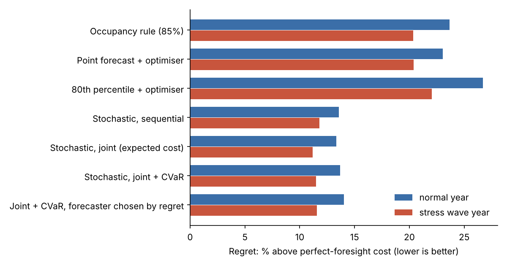
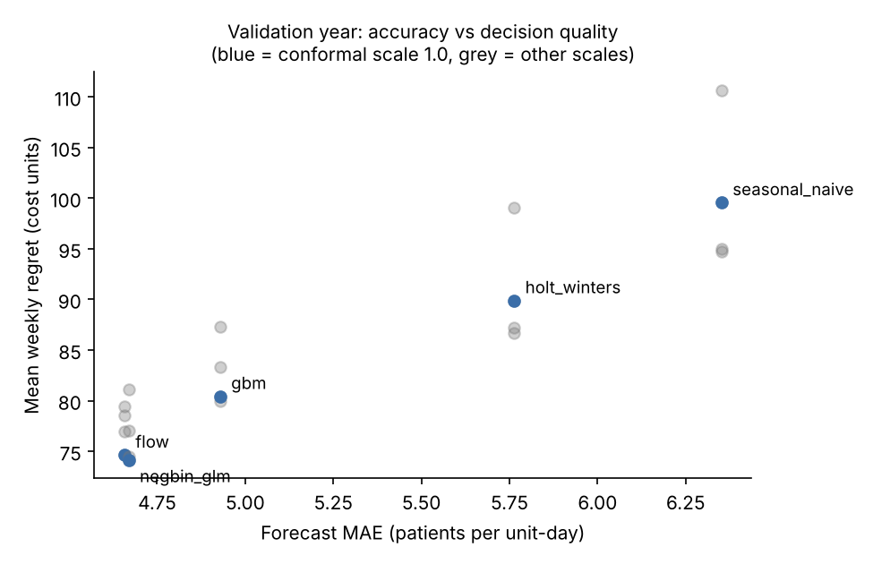

# Results: forecast-then-allocate on semi-synthetic data

> **Data notice.** Every number below comes from the semi-synthetic hospital simulator in `hcalloc.data.synthetic` (seed 0). Staffing, equipment and administrator behaviour are simulated. These results test the method; they are not evidence about any real hospital.

Run time: 732 s. Evaluation: one plan every Sunday for Monday to Sunday, 52 weeks in the test year. Costs are in units of one rostered nurse-day. Regret is realised cost minus the cost of the best plan made with perfect foresight.

## Key findings

- **Uncertainty-aware planning, normal year:** joint + CVaR is 13.7% above perfect foresight, against 23.0% for the best method that ignores uncertainty (point forecast + optimiser), a 41% cut in regret.
- **Uncertainty-aware planning, stress-wave year:** joint + CVaR is 11.5% above perfect foresight, against 20.3% for the best method that ignores uncertainty (occupancy rule (85%)), a 44% cut in regret.
- **Coupled fixed and movable resources:** planning beds, nurses and pumps together was not measurably better than planning them one after another on the normal year (+0.6 per week, 95% CI -2.0 to +3.6). The sensitivity table shows when coupling matters more.
- **Risk term (CVaR, weight 0.3):** worst-10%-week cost was 919 with CVaR vs 922 without (normal year) and 1,348 vs 1,343 (stress year). Mean weekly cost difference: +2.0 per week, 95% CI -0.2 to +4.2. In these runs the risk term did not clearly reduce bad-week cost.
- **Choosing forecasters by decisions:** forecaster rankings by CRPS and by decision regret agreed (Spearman 1.00); MAE agreed less (0.90). Validation regret picked `negbin_glm` (scale 1.0) and MAE picked `flow`. On the test year the regret pick minus the MAE pick was +2.1 per week, 95% CI -2.3 to +6.2, so the choice made no measurable difference. Tuning the scenario spread by regret mattered for the weaker models: `holt_winters` preferred scale 1.25 (90% coverage 0.92), `seasonal_naive` preferred scale 1.25 (90% coverage 0.93), i.e. wider scenarios than plain conformal calibration gave.
- **Override learning:** over the last 8 weeks, overrides were 48% smaller with learning (8.4 vs 16.1 beds + nurses changed per week; habitual noise alone 2.6). Learned weights ended at (2.5, 0.6) for a true (1.8, 0.5). This shows the mechanism works on a simulated administrator only.
- **Sensitivity:** joint + CVaR had lower regret than the point-forecast optimiser in every variant, by 0.1 points (bed cost 1.0 (beds as costly as a nurse)) up to 15.4 points (shortage cost x2). Joint minus sequential planning, in regret points saved (positive means joint is better): base: -0.1, shortage cost x0.5: +0.2, shortage cost x2: -0.3, pump fleet 130: +1.8, pump fleet 180: -0.0, bed cost 1.0 (beds as costly as a nurse): +0.8. Coupling helps most where a movable resource is scarce or opening beds is expensive.

## 1. Method comparison

Forecasts for every method come from the forecaster with the lowest validation MAE (`flow`), except the last row, which uses the configuration chosen by validation regret (`negbin_glm`, scenario scale 1.0).

### Normal test year

| method | mean_weekly_cost | regret_pct | cvar90_weekly_cost | shortage_patient_days | shortage_unit_day_rate_pct | idle_bed_days | excess_nurse_days | agency_nurse_days |
| --- | --- | --- | --- | --- | --- | --- | --- | --- |
| Occupancy rule (85%) | 698.3 | 23.7 | 987.9 | 431.9 | 8.7 | 8,317.4 | 2,487.6 | 30.8 |
| Point forecast + optimiser | 694.6 | 23.0 | 1,006.3 | 818.8 | 16.6 | 3,421.7 | 63.3 | 397.1 |
| 80th percentile + optimiser | 715.3 | 26.7 | 1,113.6 | 1,103.2 | 13.7 | 6,380.1 | 393.0 | 68.2 |
| Stochastic, sequential | 641.2 | 13.6 | 922.6 | 476.6 | 8.6 | 8,724.2 | 118.0 | 305.9 |
| Stochastic, joint (expected cost) | 639.8 | 13.3 | 922.2 | 482.7 | 8.7 | 7,843.0 | 64.7 | 440.1 |
| Stochastic, joint + CVaR | 641.8 | 13.7 | 919.1 | 490.2 | 8.8 | 8,326.9 | 106.8 | 297.1 |
| Perfect foresight | 564.6 | 0.0 | 860.8 | 494.6 | 7.8 | 29.9 | 0.0 | 50.6 |
| Joint + CVaR, forecaster chosen by regret | 643.9 | 14.0 | 924.5 | 475.0 | 8.6 | 9,120.6 | 161.2 | 169.4 |

Joint + CVaR minus each alternative, per week (negative means joint + CVaR is cheaper):

| compared with | weekly cost difference | 95% CI low | 95% CI high |
| --- | --- | --- | --- |
| Occupancy rule (85%) | -56.46 | -60.74 | -51.84 |
| Point forecast + optimiser | -52.81 | -70.11 | -36.79 |
| 80th percentile + optimiser | -73.54 | -100.00 | -50.00 |
| Stochastic, sequential | 0.57 | -2.05 | 3.56 |
| Stochastic, joint (expected cost) | 2.03 | -0.23 | 4.20 |

### Test year with a pandemic-like stress wave

| method | mean_weekly_cost | regret_pct | cvar90_weekly_cost | shortage_patient_days | shortage_unit_day_rate_pct | idle_bed_days | excess_nurse_days | agency_nurse_days |
| --- | --- | --- | --- | --- | --- | --- | --- | --- |
| Occupancy rule (85%) | 773.0 | 20.3 | 1,403.4 | 858.5 | 12.3 | 7,955.5 | 2,380.7 | 29.5 |
| Point forecast + optimiser | 773.2 | 20.4 | 1,414.2 | 1,335.5 | 20.1 | 3,427.2 | 62.7 | 382.9 |
| 80th percentile + optimiser | 783.9 | 22.0 | 1,401.2 | 1,568.1 | 16.1 | 6,025.8 | 328.1 | 102.7 |
| Stochastic, sequential | 718.0 | 11.8 | 1,358.1 | 904.7 | 12.1 | 8,343.8 | 133.8 | 269.7 |
| Stochastic, joint (expected cost) | 714.1 | 11.2 | 1,343.4 | 939.2 | 12.0 | 7,504.7 | 59.1 | 413.4 |
| Stochastic, joint + CVaR | 716.1 | 11.5 | 1,347.8 | 946.9 | 12.0 | 7,930.0 | 91.0 | 283.0 |
| Perfect foresight | 642.4 | 0.0 | 1,285.1 | 966.4 | 11.3 | 40.5 | 0.0 | 52.7 |
| Joint + CVaR, forecaster chosen by regret | 716.7 | 11.6 | 1,349.4 | 917.4 | 11.9 | 8,625.0 | 127.0 | 189.7 |

Joint + CVaR minus each alternative, per week (negative means joint + CVaR is cheaper):

| compared with | weekly cost difference | 95% CI low | 95% CI high |
| --- | --- | --- | --- |
| Occupancy rule (85%) | -56.89 | -60.53 | -53.10 |
| Point forecast + optimiser | -57.13 | -74.27 | -40.93 |
| 80th percentile + optimiser | -67.84 | -90.92 | -46.35 |
| Stochastic, sequential | -1.92 | -5.06 | 1.52 |
| Stochastic, joint (expected cost) | 1.99 | -0.14 | 4.11 |

## 2. Choosing the forecaster by decisions, not error

On the validation year, lowest MAE picks `flow`, lowest CRPS picks `negbin_glm`, and lowest decision regret picks `negbin_glm` with scenario scale 1.0. Spearman rank correlation between MAE and regret across forecasters: 0.90 (CRPS vs regret: 1.00).

| phase | forecaster | mae | crps | coverage90 | mean_weekly_regret | regret_pct |
| --- | --- | --- | --- | --- | --- | --- |
| select | flow | 4.657 | 3.316 | 0.843 | 74.628 | 12.970 |
| select | gbm | 4.928 | 3.501 | 0.846 | 80.419 | 13.976 |
| select | holt_winters | 5.763 | 4.128 | 0.835 | 89.877 | 15.620 |
| select | negbin_glm | 4.669 | 3.273 | 0.841 | 74.165 | 12.889 |
| select | seasonal_naive | 6.352 | 4.561 | 0.876 | 99.553 | 17.302 |
| test | flow | 4.578 | 3.339 | 0.846 | 77.217 | 13.677 |
| test | gbm | 4.760 | 3.505 | 0.837 | 82.681 | 14.645 |
| test | holt_winters | 5.589 | 4.061 | 0.842 | 89.832 | 15.911 |
| test | negbin_glm | 4.622 | 3.377 | 0.834 | 79.297 | 14.045 |
| test | seasonal_naive | 5.991 | 4.379 | 0.891 | 93.880 | 16.628 |

On the held-out test year the MAE-selected configuration has mean weekly regret 77.2 and the regret-selected one 79.3 (not lower). The best configuration in hindsight on the test year is `flow` at scale 0.75 (76.9).

## 3. Learning from administrator overrides

A simulated administrator plans with hidden weights (shortage multiplier 1.8, risk weight 0.5) and adds small habitual changes. The learner searches a bounded grid of weights by decision matching.

| period | override size, static | override size, learned | share changed, static | share changed, learned | noise floor |
| --- | --- | --- | --- | --- | --- |
| first 8 weeks | 15.25 | 10.12 | 0.24 | 0.17 | 2.00 |
| last 8 weeks | 16.12 | 8.38 | 0.25 | 0.13 | 2.62 |

Final learned weights: shortage multiplier 2.5, risk weight 0.6 (true values 1.8, 0.5; the grid holds 1.0 to 3.0 and 0, 0.3, 0.6). Realised cost over the year: static recommendations 33,482, learned 33,668, administrator's final plans 33,605. A learned recommendation can cost more under the configured costs, because it adopts the administrator's stronger aversion to shortage; shortage patient-days: static 475, learned 474.

## 4. Sensitivity to assumptions

Regret (% above perfect foresight) on the normal test year when one assumption changes at a time (forecaster `flow`). Each variant uses its own costs for both planning and scoring.

| variant | Point forecast + optimiser | Stochastic, sequential | Stochastic, joint + CVaR | Perfect foresight |
| --- | --- | --- | --- | --- |
| base | 23.0 | 13.6 | 13.7 | 0.0 |
| shortage cost x0.5 | 20.0 | 14.2 | 14.0 | 0.0 |
| shortage cost x2 | 28.0 | 12.3 | 12.6 | 0.0 |
| pump fleet 130 | 18.6 | 11.7 | 9.9 | 0.0 |
| pump fleet 180 | 27.8 | 14.3 | 14.3 | 0.0 |
| bed cost 1.0 (beds as costly as a nurse) | 12.0 | 12.7 | 11.9 | 0.0 |

## Limitations

- Demand, staffing ratios, equipment needs, costs and administrator behaviour are simulated or assumed; see `docs/assumptions.md`.
- Days are planned independently given first-stage decisions, unserved patients do not carry over, and patients cannot overflow into another unit's beds.
- One synthetic hospital and one seed; repeat with other seeds and with real aggregate data before drawing conclusions.
