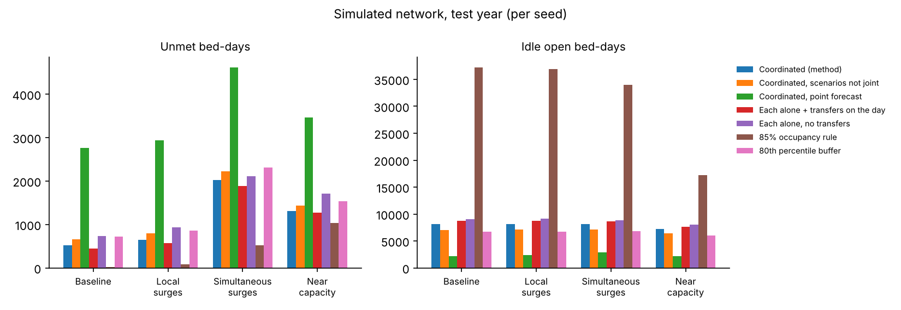
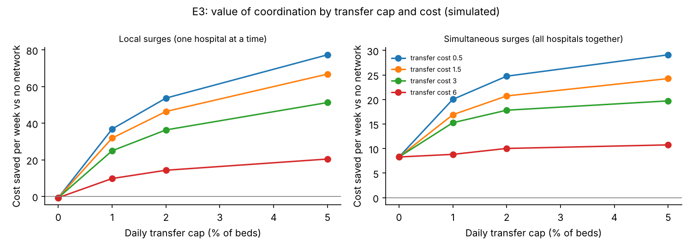
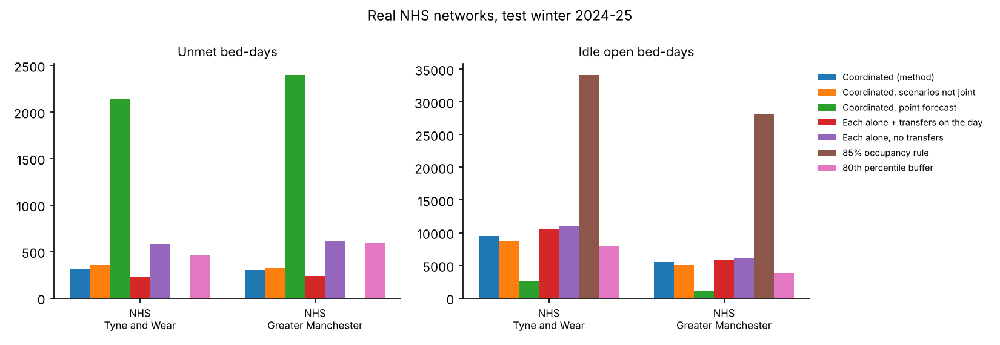
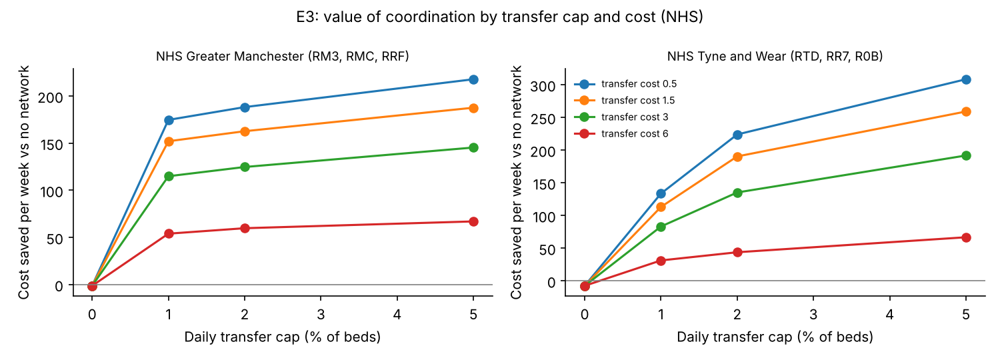

# Network results: bed reserves and transfers across hospitals (hcalloc v2)

> **Data notice.** The simulated network is SYNTHETIC. The NHS networks use real adult general and acute (G&A) beds occupied from NHS England daily sitreps (Open Government Licence v3.0); bed counts are the most beds the trust opened before the test winter. Costs, transfer caps and the 'one transfer = one bed-day' rule are assumptions.

## Key findings

1. **The transfer network is worth a lot, and more as the daily cap grows.** Against hospitals that never transfer, the
   coordinated plan saved 21 to 57 cost units per week on the simulated network and 163 to 190 per week on the two NHS
   networks, roughly halving unmet bed-days on NHS data (317 vs 580 in Tyne and Wear, 301 vs 610 in Greater Manchester).
   The saving grows with the transfer cap and shrinks as transfers cost more (E3).
2. **Synchronised surges shrink the value of the network.** With the same surges hitting one hospital at a time the
   network saved 46 per week; when they hit all hospitals together it saved 21 per week, and unmet bed-days rose two- to
   threefold for the forecast-driven policies. Spare beds next door are not there when everyone is busy.
3. **Planning with uncertainty is essential.** The same planner fed only a point forecast had 2 to 8 times more unmet
   bed-days and cost 200 to 260 per week more (simulated) and 490 to 750 per week more (NHS).
4. **The 85% occupancy rule leaves the fewest patients unplaced, but at a high price**: 2 to 5 times the idle open
   bed-days and 6 to 15% regret, against 3 to 8% for the forecast-driven policies. In simultaneous-surge weeks its
   spare beds paid off and it had the lowest cost, which is a further sign that the forecasts under-predict synchronised surges.
5. **Anticipating transfers inside the plan did not beat planning each hospital alone and transferring on the day.**
   The difference was within noise in most settings and on both NHS networks. Under simultaneous surges, planning alone
   was better (by 9 per week overall, 39 per week in surge weeks), because the coordinated plan opens fewer beds and
   counts on neighbours who turn out to be full. Joint scenarios reduce this (they beat independent scenarios by 51 per
   week in simultaneous-surge weeks) but do not remove it.

Taken together: the network and the uncertainty-aware forecast carry most of the value; relying on neighbours in the
plan itself only pays when surges are not synchronised and scenarios capture how hospitals move together. That is the
'when does it help' answer the paper can build on, with the limits below.

## Setup

- Costs: open bed-day 1.0, transfer 1.5, unplaced patient-day 8.0. Daily transfer cap per sending hospital: 2% of its beds.
- Plans: a 7-day plan of open beds per hospital every week of the test period; 40 joint demand scenarios.
- Perfect foresight (the regret benchmark) obeys the same beds, transfer cap and costs as every policy.
- Main measures: unmet bed-days, idle open bed-days, transfers. Regret is secondary.
- Simulated: 5 independent seeds per regime, 52 test weeks each; figures are per seed-year.

## E1 and E2: simulated network

### Baseline (two random local surges a year)

All test weeks:

| Policy | Unmet bed-days | Idle open bed-days | Transfers | Regret % | Cost vs method per week (95% CI) |
| --- | ---: | ---: | ---: | ---: | --- |
| Coordinated (method) | 525 | 8,101 | 353 | 5.0 | reference |
| Coordinated, scenarios not joint | 662 | 6,997 | 394 | 5.0 | -1.6 (-6.4 to +3.9) |
| Coordinated, point forecast | 2,768 | 2,208 | 562 | 9.2 | +198.5 (+160.1 to +239.1) |
| Each alone + transfers on the day | 447 | 8,710 | 292 | 5.0 | -0.5 (-3.8 to +2.5) |
| Each alone, no transfers | 739 | 9,002 | 0 | 5.8 | +36.7 (+31.6 to +41.8) |
| 85% occupancy rule | 20 | 37,232 | 25 | 15.4 | +492.3 (+458.1 to +520.6) |
| 80th percentile buffer | 720 | 6,703 | 374 | 5.0 | -0.0 (-6.2 to +6.8) |

Surge weeks only:

| Policy | Unmet bed-days | Idle open bed-days | Transfers | Regret % | Cost vs method per week (95% CI) |
| --- | ---: | ---: | ---: | ---: | --- |
| Coordinated (method) | 283 | 883 | 93 | 9.0 | reference |
| Coordinated, scenarios not joint | 313 | 779 | 96 | 9.4 | +17.6 (-1.4 to +40.2) |
| Coordinated, point forecast | 659 | 308 | 94 | 15.6 | +321.8 (+201.3 to +453.9) |
| Each alone + transfers on the day | 260 | 941 | 87 | 8.7 | -16.8 (-29.7 to -4.8) |
| Each alone, no transfers | 347 | 1,028 | 0 | 10.5 | +71.5 (+50.2 to +93.4) |
| 85% occupancy rule | 20 | 4,187 | 25 | 13.4 | +213.0 (+2.0 to +380.1) |
| 80th percentile buffer | 335 | 748 | 90 | 9.7 | +35.1 (+10.7 to +63.9) |

### Local surges (one hospital at a time)

All test weeks:

| Policy | Unmet bed-days | Idle open bed-days | Transfers | Regret % | Cost vs method per week (95% CI) |
| --- | ---: | ---: | ---: | ---: | --- |
| Coordinated (method) | 647 | 8,159 | 427 | 5.3 | reference |
| Coordinated, scenarios not joint | 799 | 7,081 | 466 | 5.3 | +0.9 (-4.4 to +6.9) |
| Coordinated, point forecast | 2,944 | 2,344 | 590 | 9.6 | +206.0 (+167.7 to +247.2) |
| Each alone + transfers on the day | 572 | 8,747 | 368 | 5.2 | -0.5 (-3.6 to +2.5) |
| Each alone, no transfers | 940 | 9,115 | 0 | 6.2 | +46.4 (+39.8 to +53.1) |
| 85% occupancy rule | 77 | 36,958 | 55 | 15.3 | +475.6 (+443.5 to +503.0) |
| 80th percentile buffer | 860 | 6,758 | 451 | 5.3 | +2.4 (-4.0 to +9.5) |

Surge weeks only:

| Policy | Unmet bed-days | Idle open bed-days | Transfers | Regret % | Cost vs method per week (95% CI) |
| --- | ---: | ---: | ---: | ---: | --- |
| Coordinated (method) | 438 | 1,979 | 182 | 7.6 | reference |
| Coordinated, scenarios not joint | 496 | 1,757 | 187 | 7.9 | +15.1 (+0.5 to +31.6) |
| Coordinated, point forecast | 1,094 | 677 | 183 | 12.8 | +257.2 (+177.2 to +345.3) |
| Each alone + transfers on the day | 419 | 2,105 | 174 | 7.5 | -1.5 (-9.0 to +5.6) |
| Each alone, no transfers | 592 | 2,279 | 0 | 9.3 | +86.8 (+68.9 to +106.7) |
| 85% occupancy rule | 77 | 8,339 | 55 | 13.4 | +285.1 (+184.7 to +367.0) |
| 80th percentile buffer | 524 | 1,660 | 181 | 8.0 | +22.1 (+5.2 to +40.7) |

### Simultaneous surges (all hospitals together)

All test weeks:

| Policy | Unmet bed-days | Idle open bed-days | Transfers | Regret % | Cost vs method per week (95% CI) |
| --- | ---: | ---: | ---: | ---: | --- |
| Coordinated (method) | 2,018 | 8,102 | 268 | 7.6 | reference |
| Coordinated, scenarios not joint | 2,229 | 7,114 | 302 | 7.8 | +10.5 (+3.8 to +18.0) |
| Coordinated, point forecast | 4,618 | 2,861 | 402 | 12.9 | +258.0 (+212.3 to +308.9) |
| Each alone + transfers on the day | 1,882 | 8,641 | 235 | 7.4 | -9.2 (-14.2 to -4.3) |
| Each alone, no transfers | 2,116 | 8,876 | 0 | 8.0 | +20.7 (+14.7 to +26.8) |
| 85% occupancy rule | 525 | 34,009 | 20 | 13.6 | +295.7 (+216.2 to +368.1) |
| 80th percentile buffer | 2,316 | 6,873 | 284 | 7.9 | +17.2 (+8.2 to +27.3) |

Surge weeks only:

| Policy | Unmet bed-days | Idle open bed-days | Transfers | Regret % | Cost vs method per week (95% CI) |
| --- | ---: | ---: | ---: | ---: | --- |
| Coordinated (method) | 1,761 | 1,548 | 50 | 15.3 | reference |
| Coordinated, scenarios not joint | 1,868 | 1,429 | 49 | 16.3 | +51.2 (+31.8 to +70.9) |
| Coordinated, point forecast | 2,720 | 925 | 40 | 24.4 | +497.9 (+376.4 to +620.2) |
| Each alone + transfers on the day | 1,685 | 1,606 | 48 | 14.6 | -39.4 (-55.0 to -25.0) |
| Each alone, no transfers | 1,733 | 1,654 | 0 | 15.1 | -13.9 (-30.3 to +1.3) |
| 85% occupancy rule | 525 | 4,859 | 20 | 7.3 | -441.6 (-677.9 to -225.9) |
| 80th percentile buffer | 1,925 | 1,404 | 38 | 16.8 | +80.5 (+53.8 to +109.2) |

### Near capacity (about 95% full all year)

All test weeks:

| Policy | Unmet bed-days | Idle open bed-days | Transfers | Regret % | Cost vs method per week (95% CI) |
| --- | ---: | ---: | ---: | ---: | --- |
| Coordinated (method) | 1,306 | 7,261 | 480 | 3.4 | reference |
| Coordinated, scenarios not joint | 1,441 | 6,416 | 503 | 3.4 | +2.7 (-2.0 to +8.0) |
| Coordinated, point forecast | 3,468 | 2,212 | 633 | 7.1 | +202.3 (+164.3 to +244.0) |
| Each alone + transfers on the day | 1,276 | 7,644 | 432 | 3.4 | +2.0 (-1.1 to +5.0) |
| Each alone, no transfers | 1,708 | 8,076 | 0 | 4.5 | +57.1 (+49.7 to +64.6) |
| 85% occupancy rule | 1,040 | 17,213 | 281 | 6.2 | +152.8 (+130.0 to +176.0) |
| 80th percentile buffer | 1,530 | 6,018 | 493 | 3.5 | +6.8 (+0.1 to +14.2) |

Surge weeks only:

| Policy | Unmet bed-days | Idle open bed-days | Transfers | Regret % | Cost vs method per week (95% CI) |
| --- | ---: | ---: | ---: | ---: | --- |
| Coordinated (method) | 541 | 818 | 121 | 3.2 | reference |
| Coordinated, scenarios not joint | 558 | 739 | 124 | 3.3 | +6.3 (-6.6 to +23.1) |
| Coordinated, point forecast | 780 | 300 | 113 | 6.2 | +178.6 (+87.1 to +282.3) |
| Each alone + transfers on the day | 541 | 822 | 116 | 3.2 | -0.4 (-11.0 to +10.6) |
| Each alone, no transfers | 658 | 939 | 0 | 5.1 | +117.8 (+89.8 to +146.8) |
| 85% occupancy rule | 487 | 1,613 | 109 | 4.2 | +61.9 (+12.4 to +112.0) |
| 80th percentile buffer | 581 | 653 | 120 | 3.5 | +17.9 (-3.1 to +42.3) |

## E3: sensitivity to transfer cost and cap (simulated)

Cost saved per week by the coordinated plan, against each hospital alone with transfers on the day (`gain_vs_alone`) and against no network at all (`gain_vs_isolated`):

| label        |   transfer_cost |   cap_share |   gain_vs_alone |   gain_vs_isolated |
|:-------------|----------------:|------------:|----------------:|-------------------:|
| local        |             0.5 |        0    |           -0.67 |              -0.67 |
| local        |             0.5 |        0.01 |           -0.71 |              36.85 |
| local        |             0.5 |        0.02 |           -0.37 |              53.72 |
| local        |             0.5 |        0.05 |            1.73 |              77.35 |
| local        |             1.5 |        0    |           -0.67 |              -0.67 |
| local        |             1.5 |        0.01 |           -0.66 |              31.89 |
| local        |             1.5 |        0.02 |           -0.47 |              46.41 |
| local        |             1.5 |        0.05 |            1.28 |              66.82 |
| local        |             3   |        0    |           -0.67 |              -0.67 |
| local        |             3   |        0.01 |           -0.09 |              24.95 |
| local        |             3   |        0.02 |            0.28 |              36.34 |
| local        |             3   |        0.05 |            0.86 |              51.27 |
| local        |             6   |        0    |           -0.67 |              -0.67 |
| local        |             6   |        0.01 |           -0.22 |               9.8  |
| local        |             6   |        0.02 |           -0.11 |              14.31 |
| local        |             6   |        0.05 |            0.27 |              20.43 |
| simultaneous |             0.5 |        0    |            8.29 |               8.29 |
| simultaneous |             0.5 |        0.01 |           -6.47 |              20.03 |
| simultaneous |             0.5 |        0.02 |           -9.75 |              24.75 |
| simultaneous |             0.5 |        0.05 |           -7.51 |              29.11 |
| simultaneous |             1.5 |        0    |            8.29 |               8.29 |
| simultaneous |             1.5 |        0.01 |           -6.07 |              16.9  |
| simultaneous |             1.5 |        0.02 |           -9.17 |              20.73 |
| simultaneous |             1.5 |        0.05 |           -7.47 |              24.26 |
| simultaneous |             3   |        0    |            8.29 |               8.29 |
| simultaneous |             3   |        0.01 |           -2.4  |              15.27 |
| simultaneous |             3   |        0.02 |           -5.18 |              17.82 |
| simultaneous |             3   |        0.05 |           -4.69 |              19.72 |
| simultaneous |             6   |        0    |            8.29 |               8.29 |
| simultaneous |             6   |        0.01 |            1.76 |               8.82 |
| simultaneous |             6   |        0.02 |            0.83 |              10.03 |
| simultaneous |             6   |        0.05 |            0.99 |              10.75 |

## E1 and E2: real NHS networks (test winter 2024-25)

### NHS Tyne and Wear (RTD, RR7, R0B)

Trusts: RTD The Newcastle Upon Tyne Hospitals NHS Foundation Trust, RR7 Gateshead Health NHS Foundation Trust, R0B South Tyneside and Sunderland NHS Foundation Trust. Beds: {'RTD': 1310, 'RR7': 506, 'R0B': 1142}. Mean test occupancy: {'RTD': 0.884, 'RR7': 0.87, 'R0B': 0.871}. Transfer cap per day: {'RTD': 26, 'RR7': 10, 'R0B': 23}. 14 weeks from 2024-12-22 to 2025-03-23; forecaster holt_winters (test MAE 23.5 beds per trust-day).

All test weeks:

| Policy | Unmet bed-days | Idle open bed-days | Transfers | Regret % | Cost vs method per week (95% CI) |
| --- | ---: | ---: | ---: | ---: | --- |
| Coordinated (method) | 317 | 9,451 | 461 | 4.9 | reference |
| Coordinated, scenarios not joint | 352 | 8,778 | 475 | 4.7 | -29.1 (-68.5 to +15.7) |
| Coordinated, point forecast | 2,144 | 2,562 | 1,107 | 7.6 | +490.6 (+27.0 to +1029.0) |
| Each alone + transfers on the day | 224 | 10,610 | 356 | 5.0 | +25.0 (-32.9 to +73.9) |
| Each alone, no transfers | 580 | 10,966 | 0 | 5.9 | +190.3 (+90.6 to +310.8) |
| 85% occupancy rule | 0 | 34,123 | 0 | 13.4 | +1554.4 (+1287.2 to +1767.2) |
| 80th percentile buffer | 466 | 7,913 | 560 | 4.7 | -24.8 (-109.6 to +70.0) |

Peak weeks (busiest quarter of the winter):

| Policy | Unmet bed-days | Idle open bed-days | Transfers | Regret % | Cost vs method per week (95% CI) |
| --- | ---: | ---: | ---: | ---: | --- |
| Coordinated (method) | 267 | 2,029 | 212 | 5.7 | reference |
| Coordinated, scenarios not joint | 301 | 1,908 | 214 | 5.8 | +30.0 (-48.2 to +120.2) |
| Coordinated, point forecast | 1,097 | 622 | 287 | 11.7 | +1128.9 (-266.5 to +2524.2) |
| Each alone + transfers on the day | 201 | 2,292 | 192 | 5.4 | -57.2 (-191.2 to +76.8) |
| Each alone, no transfers | 393 | 2,484 | 0 | 7.0 | +254.8 (+75.4 to +602.4) |
| 85% occupancy rule | 0 | 8,229 | 0 | 11.0 | +1003.2 (+433.8 to +1387.8) |
| 80th percentile buffer | 367 | 1,716 | 232 | 6.2 | +104.2 (-120.0 to +328.5) |

### NHS Greater Manchester (RM3, RMC, RRF)

Trusts: RM3 Northern Care Alliance NHS Ft, RMC Bolton NHS Foundation Trust, RRF Wrightington, Wigan and Leigh NHS Foundation Trust. Beds: {'RM3': 1587, 'RMC': 569, 'RRF': 453}. Mean test occupancy: {'RM3': 0.86, 'RMC': 0.918, 'RRF': 0.941}. Transfer cap per day: {'RM3': 32, 'RMC': 11, 'RRF': 9}. 14 weeks from 2024-12-22 to 2025-03-23; forecaster holt_winters (test MAE 15.6 beds per trust-day).

All test weeks:

| Policy | Unmet bed-days | Idle open bed-days | Transfers | Regret % | Cost vs method per week (95% CI) |
| --- | ---: | ---: | ---: | ---: | --- |
| Coordinated (method) | 301 | 5,520 | 377 | 3.6 | reference |
| Coordinated, scenarios not joint | 332 | 5,089 | 399 | 3.5 | -12.9 (-40.5 to +20.3) |
| Coordinated, point forecast | 2,399 | 1,166 | 491 | 8.2 | +750.2 (+291.8 to +1267.3) |
| Each alone + transfers on the day | 235 | 5,825 | 375 | 3.5 | -11.4 (-49.6 to +21.9) |
| Each alone, no transfers | 610 | 6,200 | 0 | 4.6 | +162.7 (+90.8 to +244.3) |
| 85% occupancy rule | 0 | 28,122 | 13 | 12.4 | +1424.9 (+1209.3 to +1610.6) |
| 80th percentile buffer | 595 | 3,844 | 458 | 3.8 | +36.0 (-95.8 to +214.6) |

Peak weeks (busiest quarter of the winter):

| Policy | Unmet bed-days | Idle open bed-days | Transfers | Regret % | Cost vs method per week (95% CI) |
| --- | ---: | ---: | ---: | ---: | --- |
| Coordinated (method) | 224 | 1,186 | 178 | 4.5 | reference |
| Coordinated, scenarios not joint | 269 | 1,002 | 186 | 4.7 | +35.8 (-39.8 to +111.2) |
| Coordinated, point forecast | 1,123 | 308 | 114 | 12.5 | +1329.8 (+71.8 to +2587.8) |
| Each alone + transfers on the day | 188 | 1,185 | 208 | 4.2 | -52.0 (-132.0 to +28.0) |
| Each alone, no transfers | 396 | 1,393 | 0 | 6.3 | +286.0 (+135.5 to +436.5) |
| 85% occupancy rule | 0 | 6,711 | 13 | 10.1 | +927.4 (+574.9 to +1167.2) |
| 80th percentile buffer | 470 | 827 | 179 | 6.6 | +341.1 (-11.5 to +740.6) |

### E3 on NHS networks

| label              |   transfer_cost |   cap_share |   gain_vs_alone |   gain_vs_isolated |
|:-------------------|----------------:|------------:|----------------:|-------------------:|
| greater_manchester |             0.5 |        0    |           -1.29 |              -1.29 |
| greater_manchester |             0.5 |        0.01 |            9.68 |             174.68 |
| greater_manchester |             0.5 |        0.02 |          -12.64 |             188.25 |
| greater_manchester |             0.5 |        0.05 |          -15.79 |             217.79 |
| greater_manchester |             1.5 |        0    |           -1.29 |              -1.29 |
| greater_manchester |             1.5 |        0.01 |            9.04 |             152.04 |
| greater_manchester |             1.5 |        0.02 |          -11.43 |             162.68 |
| greater_manchester |             1.5 |        0.05 |          -14.82 |             187.61 |
| greater_manchester |             3   |        0    |           -1.29 |              -1.29 |
| greater_manchester |             3   |        0.01 |            4.93 |             114.93 |
| greater_manchester |             3   |        0.02 |           -9.21 |             124.71 |
| greater_manchester |             3   |        0.05 |          -10.36 |             145.36 |
| greater_manchester |             6   |        0    |           -1.29 |              -1.29 |
| greater_manchester |             6   |        0.01 |           10    |              54    |
| greater_manchester |             6   |        0.02 |            6.21 |              59.79 |
| greater_manchester |             6   |        0.05 |            4.71 |              67    |
| tyne_and_wear      |             0.5 |        0    |           -7.5  |              -7.5  |
| tyne_and_wear      |             0.5 |        0.01 |           13.54 |             133.54 |
| tyne_and_wear      |             0.5 |        0.02 |           33.18 |             223.89 |
| tyne_and_wear      |             0.5 |        0.05 |           39.93 |             308.32 |
| tyne_and_wear      |             1.5 |        0    |           -7.5  |              -7.5  |
| tyne_and_wear      |             1.5 |        0.01 |            9.07 |             113.07 |
| tyne_and_wear      |             1.5 |        0.02 |           25.04 |             190.32 |
| tyne_and_wear      |             1.5 |        0.05 |           26.39 |             259    |
| tyne_and_wear      |             3   |        0    |           -7.5  |              -7.5  |
| tyne_and_wear      |             3   |        0.01 |            3.14 |              83.14 |
| tyne_and_wear      |             3   |        0.02 |            8.07 |             135.21 |
| tyne_and_wear      |             3   |        0.05 |           12.79 |             191.71 |
| tyne_and_wear      |             6   |        0    |           -7.5  |              -7.5  |
| tyne_and_wear      |             6   |        0.01 |           -0.71 |              31.29 |
| tyne_and_wear      |             6   |        0.02 |           -7.07 |              43.79 |
| tyne_and_wear      |             6   |        0.05 |           -4.86 |              66.71 |

## Files

- `sim_weekly.csv`, `nhs_weekly.csv`: one row per week and policy (every measure).
- `*_summary.csv`: totals with paired bootstrap 95% intervals against the coordinated method.
- `*_sweep_*.csv`: E3 sweeps. `run_metadata.json`: settings, forecasters, trust details.
