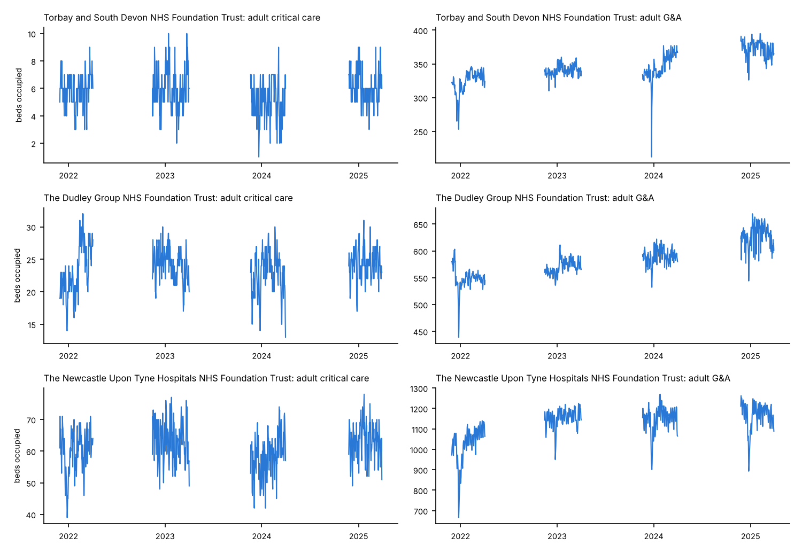
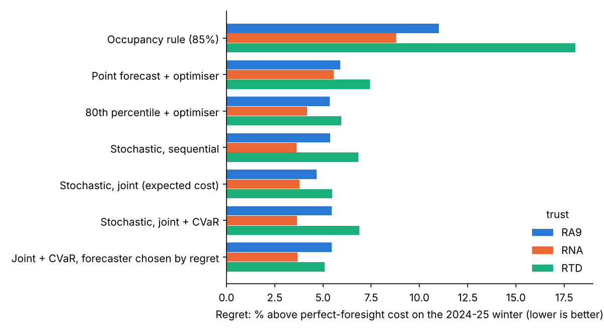

# Results on real NHS bed occupancy (UEC daily sitreps)

> **Data notice.** Demand here is **real**: adult general and acute (G&A) and adult critical care beds occupied, per trust per day, from NHS England's Urgent and Emergency Care Daily Situation Reports (8am snapshot; unvalidated management information; Open Government Licence v3.0). Everything else is **assumed**: the bed base is the most beds the trust opened in earlier winters, and nurse ratios, nurse pools, agency limits, infusion pumps and all costs come from `StaffingAssumptions` in `hcalloc/sitrep.py`, not from the trusts. Regret and cost figures therefore show how the methods behave on real demand patterns, not what any trust would save.

Seasons: 2021-11-29 to 2022-04-03, 2022-11-14 to 2023-04-02, 2023-11-20 to 2024-03-31, 2024-11-25 to 2025-03-30. Selection: fit on 2021-22, calibrate scenarios on 2022-23, evaluate 15 weekly plans in 2023-24. Test: fit on 2021-22, 2022-23, calibrate on 2023-24, evaluate 14 weekly plans in 2024-25 (2024-12-22 to 2025-03-23). The first 4 weeks of each winter are history only. Plans are made each Sunday for Monday to Sunday, with two units (adult critical care as `ICU`, adult G&A as `G&A`). Sitreps publish census only, so the flow forecaster is not used. Run time 92 s.

## Trusts and data

| trust | name | G&A bed base | CC bed base | nurse pool (assumed) | pump fleet (assumed) | days used | values blanked as errors | days interpolated |
| --- | --- | --- | --- | --- | --- | --- | --- | --- |
| RA9 | Torbay and South Devon NHS Foundation Trust | 393 | 10 | 80 | 238 | 525 | 0 | 0 |
| RNA | The Dudley Group NHS Foundation Trust | 650 | 39 | 148 | 464 | 525 | 2 | 1 |
| RTD | The Newcastle Upon Tyne Hospitals NHS Foundation Trust | 1310 | 90 | 307 | 971 | 525 | 1 | 0 |

Mean occupancy by winter (beds occupied / beds open):

| trust | season | G&A occupancy % | ICU occupancy % |
| --- | --- | --- | --- |
| RA9 | 2021-22 | 96.0 | 58.5 |
| RA9 | 2022-23 | 97.6 | 59.1 |
| RA9 | 2023-24 | 97.0 | 50.5 |
| RA9 | 2024-25 | 97.7 | 60.1 |
| RNA | 2021-22 | 94.1 | 69.4 |
| RNA | 2022-23 | 95.5 | 76.9 |
| RNA | 2023-24 | 97.5 | 72.2 |
| RNA | 2024-25 | 97.8 | 83.3 |
| RTD | 2021-22 | 84.0 | 72.7 |
| RTD | 2022-23 | 93.2 | 71.3 |
| RTD | 2023-24 | 89.9 | 67.7 |
| RTD | 2024-25 | 91.3 | 77.3 |

## 1. Forecast accuracy on the 2024-25 winter

Census 1 to 7 days ahead, pooled over both units. MASE below 1 beats last week's value; coverage is the share of actual values inside the central 80% and 90% of the conformal scenarios. Error % is total absolute error over total occupied beds, per unit.

| trust | forecaster | mae | mase_vs_naive | crps | coverage80 | coverage90 | G&A error % | ICU error % |
| --- | --- | --- | --- | --- | --- | --- | --- | --- |
| RA9 | seasonal_naive | 6.20 | 1.00 | 4.57 | 0.85 | 0.93 | 3.02 | 19.62 |
| RA9 | holt_winters | 5.66 | 0.91 | 4.21 | 0.82 | 0.91 | 2.76 | 17.34 |
| RA9 | gbm | 6.24 | 1.01 | 4.91 | 0.80 | 0.89 | 3.09 | 16.25 |
| RA9 | negbin_glm | 8.12 | 1.31 | 4.25 | 0.78 | 0.84 | 4.14 | 14.43 |
| RNA | seasonal_naive | 11.92 | 1.00 | 8.89 | 0.74 | 0.82 | 3.32 | 12.06 |
| RNA | holt_winters | 12.51 | 1.05 | 9.02 | 0.70 | 0.82 | 3.57 | 10.48 |
| RNA | gbm | 10.07 | 0.85 | 7.30 | 0.74 | 0.84 | 2.85 | 9.11 |
| RNA | negbin_glm | 14.21 | 1.19 | 8.54 | 0.60 | 0.74 | 4.19 | 8.52 |
| RTD | seasonal_naive | 27.00 | 1.00 | 21.19 | 0.74 | 0.85 | 4.18 | 8.71 |
| RTD | holt_winters | 20.08 | 0.74 | 15.60 | 0.78 | 0.89 | 3.06 | 7.31 |
| RTD | gbm | 19.26 | 0.71 | 14.67 | 0.74 | 0.88 | 2.99 | 6.17 |
| RTD | negbin_glm | 23.20 | 0.86 | 16.10 | 0.66 | 0.76 | 3.66 | 6.37 |

## 2. Choosing the forecaster by decisions

Each forecaster and scenario scale is scored on the 2023-24 winter by the regret of the joint + CVaR plans it produces. With 4 forecasters the rank correlations are coarse.

| trust | lowest MAE | lowest CRPS | lowest regret (forecaster, scale) | Spearman MAE vs regret | Spearman CRPS vs regret |
| --- | --- | --- | --- | --- | --- |
| RA9 | gbm | gbm | gbm (1.0) | 0.40 | 0.80 |
| RNA | gbm | gbm | negbin_glm (1.25) | 0.80 | 0.80 |
| RTD | holt_winters | negbin_glm | negbin_glm (0.75) | -0.80 | 0.80 |

## 3. Method comparison on the 2024-25 winter

Forecasts for every method come from each trust's lowest-validation-MAE forecaster, except the last row (configuration chosen by validation regret). Costs are in assumed units of one rostered nurse-day.

### RA9: Torbay and South Devon NHS Foundation Trust

| method | mean_weekly_cost | regret_pct | cvar90_weekly_cost | shortage_patient_days | shortage_unit_day_rate_pct | idle_bed_days | agency_nurse_days |
| --- | --- | --- | --- | --- | --- | --- | --- |
| Occupancy rule (85%) | 1,343.1 | 11.0 | 1,354.6 | 1.0 | 0.5 | 2,240.0 | 1.3 |
| Point forecast + optimiser | 1,281.4 | 5.9 | 1,375.8 | 22.0 | 4.6 | 859.0 | 73.0 |
| 80th percentile + optimiser | 1,274.8 | 5.4 | 1,301.7 | 1.5 | 0.5 | 1,715.5 | 9.3 |
| Stochastic, sequential | 1,274.9 | 5.4 | 1,294.2 | 0.0 | 0.0 | 2,167.0 | 17.8 |
| Stochastic, joint (expected cost) | 1,266.3 | 4.7 | 1,289.2 | 1.5 | 0.5 | 1,821.5 | 22.8 |
| Stochastic, joint + CVaR | 1,276.0 | 5.5 | 1,293.6 | 1.5 | 0.5 | 2,168.5 | 14.8 |
| Perfect foresight | 1,210.0 | 0.0 | 1,244.2 | 0.0 | 0.0 | 0.0 | 33.0 |
| Joint + CVaR, forecaster chosen by regret | 1,276.0 | 5.5 | 1,293.6 | 1.5 | 0.5 | 2,168.5 | 14.8 |

### RNA: The Dudley Group NHS Foundation Trust

| method | mean_weekly_cost | regret_pct | cvar90_weekly_cost | shortage_patient_days | shortage_unit_day_rate_pct | idle_bed_days | agency_nurse_days |
| --- | --- | --- | --- | --- | --- | --- | --- |
| Occupancy rule (85%) | 2,340.8 | 8.8 | 2,381.3 | 0.0 | 0.0 | 2,583.0 | 0.7 |
| Point forecast + optimiser | 2,271.2 | 5.6 | 2,402.7 | 20.0 | 4.1 | 1,131.0 | 181.5 |
| 80th percentile + optimiser | 2,241.6 | 4.2 | 2,304.3 | 1.0 | 0.5 | 1,867.0 | 43.8 |
| Stochastic, sequential | 2,229.6 | 3.6 | 2,277.6 | 0.0 | 0.0 | 2,181.0 | 110.8 |
| Stochastic, joint (expected cost) | 2,233.4 | 3.8 | 2,293.6 | 0.2 | 0.0 | 1,956.0 | 169.7 |
| Stochastic, joint + CVaR | 2,230.3 | 3.6 | 2,281.2 | 0.0 | 0.0 | 2,221.0 | 106.8 |
| Perfect foresight | 2,151.7 | 0.0 | 2,210.2 | 0.0 | 0.0 | 0.0 | 32.8 |
| Joint + CVaR, forecaster chosen by regret | 2,230.8 | 3.7 | 2,304.7 | 0.0 | 0.0 | 2,025.0 | 175.2 |

### RTD: The Newcastle Upon Tyne Hospitals NHS Foundation Trust

| method | mean_weekly_cost | regret_pct | cvar90_weekly_cost | shortage_patient_days | shortage_unit_day_rate_pct | idle_bed_days | agency_nurse_days |
| --- | --- | --- | --- | --- | --- | --- | --- |
| Occupancy rule (85%) | 4,774.8 | 18.1 | 4,848.2 | 0.0 | 0.0 | 15,263.0 | 2.0 |
| Point forecast + optimiser | 4,344.8 | 7.4 | 5,194.5 | 138.0 | 4.1 | 2,109.0 | 354.8 |
| 80th percentile + optimiser | 4,283.9 | 5.9 | 4,650.6 | 23.0 | 1.5 | 4,738.0 | 83.0 |
| Stochastic, sequential | 4,320.4 | 6.8 | 4,499.7 | 0.0 | 0.0 | 9,653.0 | 122.0 |
| Stochastic, joint (expected cost) | 4,265.6 | 5.5 | 4,581.8 | 7.0 | 1.0 | 6,048.0 | 272.3 |
| Stochastic, joint + CVaR | 4,322.2 | 6.9 | 4,502.8 | 0.0 | 0.0 | 9,662.0 | 121.0 |
| Perfect foresight | 4,043.9 | 0.0 | 4,209.8 | 0.0 | 0.0 | 0.0 | 29.8 |
| Joint + CVaR, forecaster chosen by regret | 4,249.8 | 5.1 | 4,612.1 | 19.0 | 3.6 | 3,612.0 | 522.0 |

### All trusts pooled

Joint + CVaR minus each alternative, in weekly regret as % of that week's perfect-foresight cost (negative means joint + CVaR is better). Paired bootstrap over trust-weeks.

| compared with | regret points difference | 95% CI low | 95% CI high | weeks |
| --- | --- | --- | --- | --- |
| Occupancy rule (85%) | -7.34 | -8.40 | -6.38 | 42 |
| Point forecast + optimiser | -0.90 | -2.76 | 0.74 | 42 |
| 80th percentile + optimiser | 0.19 | -0.51 | 0.81 | 42 |
| Stochastic, sequential | 0.06 | -0.02 | 0.16 | 42 |
| Stochastic, joint (expected cost) | 0.70 | 0.10 | 1.26 | 42 |

## Findings

- **Uncertainty-aware planning:** joint + CVaR had lower regret than the best method that ignores uncertainty in 1 of 3 trusts (RA9: 5.5% vs 5.4% for 80th percentile + optimiser; RNA: 3.6% vs 4.2% for 80th percentile + optimiser; RTD: 6.9% vs 5.9% for 80th percentile + optimiser).
- **Joint + CVaR vs occupancy rule (85%), pooled:** -7.34 regret points per week (95% CI -8.40 to -6.38): joint + CVaR better.
- **Joint + CVaR vs point forecast + optimiser, pooled:** -0.90 regret points per week (95% CI -2.76 to +0.74): no measurable difference.
- **Joint + CVaR vs 80th percentile + optimiser, pooled:** +0.19 regret points per week (95% CI -0.51 to +0.81): no measurable difference.
- **Joint + CVaR vs stochastic, sequential, pooled:** +0.06 regret points per week (95% CI -0.02 to +0.16): no measurable difference.
- **Joint + CVaR vs stochastic, joint (expected cost), pooled:** +0.70 regret points per week (95% CI +0.10 to +1.26): joint + CVaR worse.
- **Forecasting:** best test-winter MASE per trust: RA9 `holt_winters` 0.91 (90% coverage 0.91), RNA `gbm` 0.85 (90% coverage 0.84), RTD `gbm` 0.71 (90% coverage 0.88).

## Limitations

- Only demand is real. Staffing ratios, nurse pools, agency limits, pumps and costs are assumptions scaled to each trust's bed numbers; real rosters, pump fleets and cost weights would change the regret figures.
- Sitreps are winter-only (roughly late November to March), so each model is fitted on one or two short winters, and the test is one winter of 14 weekly plans per trust. Intervals are wide.
- Census is an 8am snapshot of occupied beds, not a midnight count, and is unvalidated management information that trusts can revise. Obvious reporting errors (zeros on one day, a fourfold jump) are blanked by `clean_sitreps` and gaps of up to 3 days interpolated.
- Observed occupancy is already capped by the beds each trust opened; unmet demand (patients waiting in A&E for a bed) is not in these figures, so true demand at full trusts is understated.
- 2021-22 is used only for fitting (it includes the Omicron wave).
- Three trusts, picked for size spread and complete data, not at random.
